<!-- ===================== HEADER ===================== -->
<div align="center">



<br/>

<a href="mailto:mahmoudyosry73@gmail.com"></a>
<a href="https://www.linkedin.com/in/mahmoudyousry1"></a>
<a href="https://github.com/myousry11"></a>
</div>

<br/>

<!-- ===================== ABOUT ===================== -->
## 👋 Hey, I'm Mahmoud

Mobile developer from **Cairo, Egypt** with **1.5+ years** of experience building, shipping, and maintaining production apps. I work on **real-time tracking and monitoring platforms** (Hajj 2025–2026, TWT Disability) that serve **tens of thousands of users**, and I care about clean architecture, smooth UI, and delivering on time.

```dart
const mahmoud = Developer(
  role: 'Software Engineer | Flutter Developer',
  location: 'Cairo, Egypt 🇪🇬',
  company: 'Egy Eagles for Software Solutions',
  stateManagement: ['Bloc', 'Provider', 'GetX'],
  architecture: ['Clean Architecture', 'MVC', 'MVVM'],
  languages: ['Arabic', 'English'],
  currentlyBuilding: 'Scout App ⚽ + TWT mobile apps',
);
```

<br/>

<!-- ===================== TECH STACK ===================== -->
## 🧰 Tech Stack

<div align="center">


</div>

| Area | What I use |
|:--|:--|
| 📱 **Mobile** | Dart · Flutter (Mobile & Web) · Flavors · Responsive & Adaptive UI |
| 🧠 **State Management** | Bloc · Provider · GetX |
| 🏗️ **Architecture** | Clean Architecture · MVC · MVVM |
| 🔌 **Backend & Data** | REST APIs · HTTP · Firebase · Laravel · PHP · MySQL · SQL · SQFLite |
| ⚙️ **Workflow** | Git & GitHub · CI/CD · Agile |

<br/>

<!-- ===================== SHIPPED APPS ===================== -->
## 🚀 Shipped Apps (2026)

### 🕋 TWT Hajj Ecosystem
Real-time apps built for the Hajj season, each for a different role in the journey.

| App | Who it's for | What it does |
|:--|:--|:--|
| **TWT Hajj** | Pilgrims | Track schedule, rituals, and camp location · [App Store](https://apps.apple.com/us/app/twt-hajj/id6772614222) |
| **TWT Supervisor** | Group supervisors | Monitor pilgrims, manage groups, talk to the team · [App Store](https://apps.apple.com/us/app/twt-supervisor/id6773165289) |
| **TWT Family** | Families back home | Follow a loved one's journey in real time · [App Store](https://apps.apple.com/us/app/twt-family/id6773158248) |
| **TWT Mufge** | Operational staff | Internal coordination and task management |
| **TWT Delegate** | Delegation members | Oversee assigned pilgrims and on-ground tasks |

### 🧒 TWT Disability (TWTD)
| App | Who it's for | What it does |
|:--|:--|:--|
| **TWTD Parent** | Parents | Follow children's progress, chat, calls, instant notifications · [Google Play](https://play.google.com/store/apps/details?id=com.twt.disability.parent) · [App Store](https://apps.apple.com/us/app/twtd-parent/id6827092604) |
| **TWTD Evaluator** | Evaluators | Assess children, follow up with parents, communicate with the team · [Google Play](https://play.google.com/store/apps/details?id=com.twt.evaluator) · [App Store](https://apps.apple.com/us/app/twtd-evaluator/id6827096760) |

<br/>

<!-- ===================== PROJECTS ===================== -->
## 🛠️ Featured Projects

<details open>
<summary><b>📦 Insurify</b> · Insurance management app (Freelance, 2025)</summary>
<br/>

Flutter (**GetX, MVC**) + **.NET** backend. Secure authentication, dynamic server configuration, REST API handling with HTTP, file uploads, responsive UI, and multi-language support.

[App Store](https://apps.apple.com/eg/app/gge-insurify/id6744395989) · [Google Play](https://play.google.com/store/apps/details?id=net.gazayerli.insurifyapp)
</details>

<details>
<summary><b>⚽ Scout App</b> · Sports scouting platform (Freelance, in progress)</summary>
<br/>

Flutter app connecting **players, scouts, and clubs**, with a custom **Laravel REST API**: authentication, subscriptions, payments, OTP password reset, notifications, token-based access, role-based features, and video management.
</details>

<details>
<summary><b>🚚 KM Logistics Services</b> · Flutter Web (Freelance, 2025)</summary>
<br/>

Responsive logistics and shipping website with online shipment tracking, customer inquiries, and global logistics services. 🔗 [kmlogistics.services](https://kmlogistics.services/)
</details>

<details>
<summary><b>🎓 One Percent Platform</b> · Online learning platform (Freelance, 2025)</summary>
<br/>

Built with **Laravel + MySQL**. Roles for students, instructors, and assistants, authentication, trial offers, and subscription management. 🔗 [onepercent-pl.com](https://onepercent-pl.com/)
</details>

<details>
<summary><b>🛒 GemStore</b> · Full e-commerce solution</summary>
<br/>

Customer app, delivery app, and admin panel built with **Flutter, PHP, MySQL, Firebase**, using **GetX** and **MVC**. [Source code](https://github.com/myousry11/ecommerce)
</details>

<details>
<summary><b>🌱 IoT Building Greenhouse</b> · Graduation project</summary>
<br/>

Smart greenhouse combining green energy and IoT: real-time sensor monitoring, **AI plant disease detection (YOLOv5)**, automated controls, and secure authentication. [Source code](https://github.com/myousry11/GreenhouseProject)
</details>

<details>
<summary><b>💳 Debt Management System</b> · Freelance, 2024</summary>
<br/>

Track and manage customer debts with data entry, advanced search, sorting, and filtering.
</details>

<br/>

<!-- ===================== EXPERIENCE ===================== -->
## 💼 Experience

```text
2025 ─────────────────────────────────────────────────────► Now
  │
  ●  Mar 2025 – Present
  │  Egy Eagles for Software Solutions · Flutter Developer
  │  • Real-time tracking platforms for Hajj 2025–2026
  │  • TWT Disability projects (Taatamman & Tatamen)
  │  • Tracking & monitoring solutions for enterprise clients
  │
  ●  2024 – 2025  ·  Freelance
     Insurify · Scout · KM Logistics · One Percent · Debt System
```

<br/>

<!-- ===================== EDUCATION ===================== -->
## 🎓 Education & Certificates

- **B.Sc. Computer Science**, Modern University for Technology & Information (MTI), 2020 – 2024
- 📜 *The Complete Flutter & Dart Development Course* (Arabic), Abdullah Mansour, Udemy, 2023
- 📜 *Mastering Flutter: Responsive & Adaptive UI Design* (Arabic), Tharwat Samy, Udemy, 2024

<br/>

<!-- ===================== STATS ===================== -->
## 📊 By the Numbers

<div align="center">



</div>

<br/>

<!-- ===================== CONTACT ===================== -->
## 🤝 Let's Work Together

Open to **Flutter** roles and freelance projects: mobile apps, real-time tracking, and Arabic-first UIs.

📧 **mahmoudyosry73@gmail.com**


